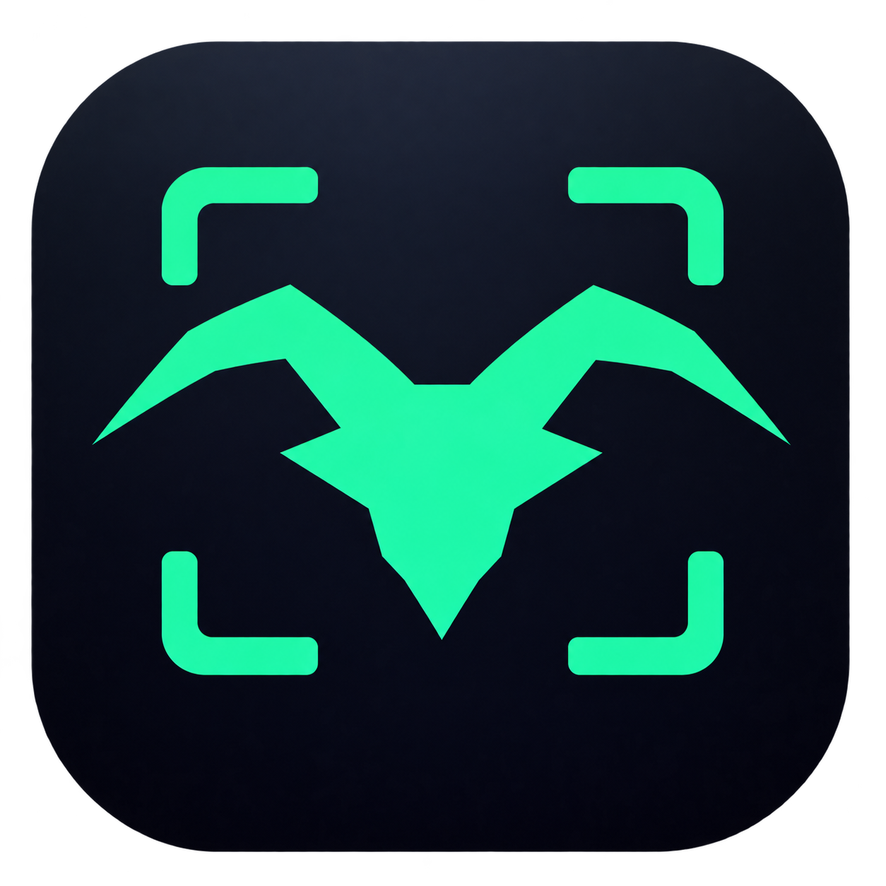
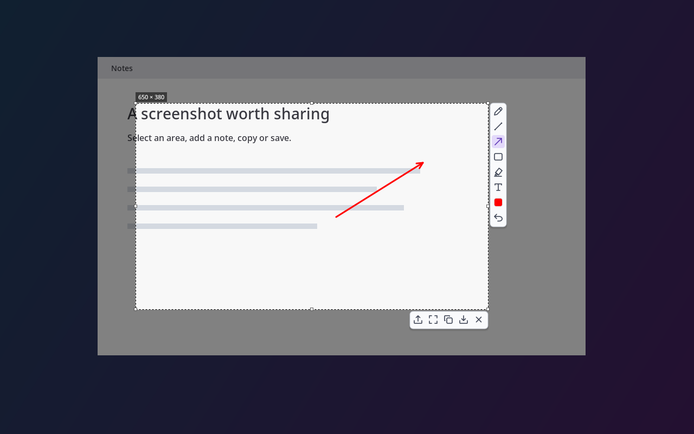

# Goatshot



A compact Linux screenshot tool by **thegoatler**, inspired by Lightshot.
Select an area, annotate it, then copy, save, or share it through your Immich server.



## Features

- Native Wayland captures through the XDG screenshot portal.
- Compact floating toolbars: pencil, line, arrow, rectangle, marker, text, color, undo.
- Selection resizing, keyboard nudging, clipboard copy, and PNG export.
- KDE system tray with settings, capture, and quit actions.
- Optional Immich uploads directly into the archive, outside your timeline.
- Six-character share links, optional vanity URLs, and configurable expiration.
- API keys stored in your desktop keyring, separately from preferences.

## Install

Goatshot currently targets **KDE Plasma on Linux**. It requires Python 3.10+,
GTK 3, PyGObject, Pycairo, Pillow, Requests, libsecret introspection, and
libdbusmenu-glib introspection. `setsid` (util-linux) is used by the restart command.

On Arch Linux / CachyOS:

```sh
sudo pacman -S python python-gobject python-cairo python-pillow python-requests gtk3 libsecret libdbusmenu-glib xdg-desktop-portal xdg-desktop-portal-kde
```

The portal backend must match your desktop. On other distributions, install the
corresponding system packages; `pip install -r requirements.txt` alone does not
provide GTK or the desktop integration libraries.

```sh
git clone https://github.com/thegoatler/goatshot.git
cd goatshot
python3 install.py
~/.local/bin/goatshot
```

Installation is per user and requires no sudo. Files go into
`~/.local/share/goatshot`, commands into `~/.local/bin`, and a desktop entry into
`~/.local/share/applications`. Add `~/.local/bin` to PATH if needed.

In KDE **System Settings → Keyboard → Shortcuts**, add Goatshot and assign
**Print Screen** to its launch action. Remove competing Print Screen bindings.
The installer preserves existing bindings and settings; it does not change
keyboard shortcuts automatically.

Approve the desktop screenshot request, then drag a selection. The editor opens
after the capture, so the toolbars do not appear in the screenshot.

## Settings and updates

Right-click the tray icon and choose **Settings**. Configure drawing color,
thickness, background dimming, save directory, copying after saving, optional
startup at login, and Immich sharing. Left-click the icon takes a screenshot.

Preferences are in `$XDG_CONFIG_HOME/goatshot/settings.json` (normally
`~/.config/goatshot/settings.json`). Startup at login starts only the tray.

After updating the checkout, run:

```sh
python3 install.py
~/.local/bin/goatshot-restart
```

Restart closes any open capture and releases clipboard data owned by the old
process. It detaches from the terminal and logs to
`$XDG_STATE_HOME/goatshot/goatshot.log` (normally `~/.local/state/goatshot/`).

Options: `--settings`, `--background`, `--quit`, and
`--image /path/to/image.png --windowed`. Repeated launches reuse the process.

## Keyboard controls

| Action | Shortcut |
|---|---|
| Copy selection | Ctrl+C or Enter |
| Save PNG | Ctrl+S |
| Undo / redo | Ctrl+Z / Ctrl+Shift+Z or Ctrl+Y |
| Pencil / line / arrow / rectangle | P / L / A / R |
| Marker / text / selection | H / T / V |
| Move selection | Arrow keys |
| Resize selection | Shift+arrow keys |
| Select full image | Ctrl+A |
| Clear selection and annotations | Delete |
| Cancel capture | Escape |

Drag the handles to resize. Right-click returns to selection mode. Scroll to
change stroke thickness. For text, click, type, and press Enter to finish.

## Immich sharing

Enter your own server URL and API key in Settings. No server or key is bundled.
The key needs `asset.upload` and `sharedLink.create`; add `asset.update` to archive
existing screenshots when Immich detects duplicate content.

Click the upload arrow to send **only the cropped, annotated PNG**. Links use
`https://photos.example.com/s/a7k2m9`, with six random lowercase letters/digits.
Automatic collisions retry without reuploading. Enable **Custom vanity URL**
(unchecked for each capture) to choose a name, such as `project-preview`.
Names allow 1–64 letters, numbers, hyphens, and underscores; a taken custom name
shows an error. Custom share URLs require Immich v1.137.0 or later.

Successful sharing copies the link and opens a dialog with Copy and Open actions.
Expiry is configurable; 0 means no expiry. Visitor uploads are disabled and
metadata is hidden. Revoking links is handled in Immich. Existing screenshots
are not retroactively archived by installation.

If uploading succeeds but archiving or sharing fails, the image remains in
Immich and the editor stays open. Requests use normal TLS verification and do
not forward credentials through redirects. API keys use the desktop Secret
Service keyring, scoped to the server URL. Leaving the key field blank keeps the
saved key. See the [Immich API documentation](https://api.immich.app/).

## Development and tests

```sh
python3 -m unittest -v
```

Tests cover exports, selection geometry, toolbar bounds, text entry, undo/redo,
settings, installation, tray interface types, portal responses, and mocked
Immich requests. Live capture permissions, tray display, clipboard behavior,
and server uploads require a desktop session. `preview.png` uses a synthetic
background rendered by the actual editor.

The app stays idle after a capture so it can continue serving clipboard images
on Wayland. On multiple monitors, the portal screenshot is fitted into one
fullscreen editor; exports retain original pixels. Overlays spanning physical
monitors are not implemented. Other desktop environments are not verified.

Goatshot is an independent implementation. It does not use Lightshot code or its
upload service. The application icon was generated with AI. The internal app ID
and keyring schema retain the former Snaplight identifiers to preserve existing
shortcuts and stored keys during upgrades.
